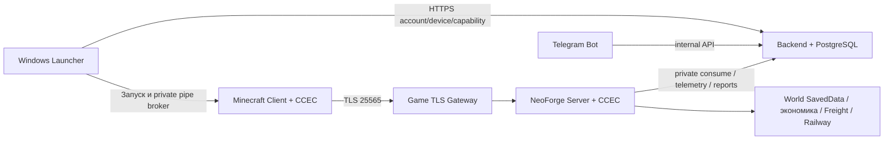

# RE:CRETED / CCEC — актуальный State

Срез: **14 октября 2026**, Europe/Minsk. Источники: фактический MERGED checkout CCEC, актуальные исходники соседнего CreateServerPlatform, GitNexus и read-only SSH production. Это функциональный и архитектурный аудит; успешные suites не являются доказательством отсутствия всех ошибок или прохождения игры.

## Что представляет собой проект

RE:CREATED — управляемая Minecraft/Create платформа. CCEC добавляет города, территорию, промышленную геологию и шахты, металлургию, экономику, физическую логистику и железнодорожную собственность. Windows launcher управляет аккаунтом, доверенным устройством, обновлением клиента и запуском игры. Backend владеет platform identity и допуском; CCEC владеет игровым миром и расчётами. Telegram используется для подтверждений, панели управления, reports и broadcasts.

## Источник истины и передача команде

- GitHub: https://github.com/DanielSolonskii/CreateCityExpansionCore
- Рабочая ветка: `codex/next-ai-work`. На начало аудита HEAD `9e6ff5a6cc1ddc7f43fd9c419864e206ef41658a`; удалённая рабочая ветка совпадала с этим HEAD. `main` был `bd2497c409dde688891837ae6846a8835d4d843b`.
- До фиксации были 65 изменённых tracked-файлов, 1 удалённый и 127 untracked записей верхнего уровня. Это не количество исходников: untracked directories содержали много файлов, включая черновые копии платформы.
- По указанию владельца **актуальные 345 файлов CreateServerPlatform скопированы в `platform/` с побайтовой SHA-256 сверкой**. Git history соседнего репозитория не импортировалась; исходный checkout оставлен на месте.
- Для команды рабочим источником становится этот монорепозиторий. Нельзя редактировать одновременно старый соседний checkout и `platform/` без явно согласованной синхронизации.
- Кэши, node_modules, target/build/dist, releases/release-input, приватные env/secrets, мир и пользовательские credentials не включены. Старые `tools/*-platform` — исторические рабочие копии; текущая платформа находится в `platform/`.
- Commit/push сохраняют исходники. Они не выкладывают новую игровую сборку, backend или installer на рабочий сервер.

## Проверенный production

| Объект | Проверено 14.10.2026 |
| --- | --- |
| SSH | `root@186.246.28.214`, key-based BatchMode подключение с компьютера владельца работает |
| Minecraft | `create-server-minecraft.service`, active/running, `/opt/create-server/minecraft` |
| Backend | `create-server-backend.service`, active/running, `/opt/create-server/backend` |
| Telegram bot | `create-server-telegram-bot.service`, active/running, `/opt/create-server/telegram-bot` |
| Game TLS | `create-server-game-tls.service`, active/running |
| HTTPS/API | Caddy; `https://api.recreated.ru/api/health` → UP, postgres UP |
| Database | PostgreSQL 18 service; loopback 5432 |
| Backend API bind | loopback 8080; публичный вход через HTTPS allowlist |
| Game bind | публичный TLS TCP 186.246.28.214:25565 → raw loopback TCP 127.0.0.1:25565 |
| CCEC auth | mode REQUIRED; backend loopback; serverId recreated-alpha |
| Production game channel | alpha → alpha-0.1.18 |
| Production launcher | latest → versions/0.1.5; публичный installer отвечает HTTP 200 |
| Последний найденный startup | journal: Loaded 15050 recipes; Done 22:24:22 12.10.2026 |
| Quest definitions | `config/ftbquests/quests`, 6 CCEC chapters обнаружены |
| Quest progress | `world/ftbquests`, хранится отдельно от definitions |

Production CCEC: `createcityexpansioncore-1.0.1.jar`, SHA-256
`7c62c72fde7634f208d3db9d4e90b5f19d349835500ad3248e4022e5cd40fd86`.

Новая локальная сборка после check/build: SHA-256
`15bc00868ebe2b639efc1c506da18ce5fcc7c009664994f32be0efc9beae687f`.
Различие подтверждено: текущий исходный код нельзя объявлять полностью выложенным на production. Хеш JAR привязан к этой сборке, не является гарантией побайтовой воспроизводимости всех будущих Gradle builds. Локальный launcher version **0.1.6**; production latest пока **0.1.5**.

SSH от сотрудников ещё не проверен: их личные ключи и аккаунты будут выданы позже. Работающий SSH владельца не выдаёт доступ автоматически другим компьютерам.

## Реализованные системы

Полная разметка — [CHECKLIST_RU.md](CHECKLIST_RU.md), машинный каталог — [feature-catalog.json](feature-catalog.json). 35 разделов реализации и 14 открытых этапов, распределённых по M0–M7.

| Этап | Что уже есть в исходниках |
| --- | --- |
| M0 | Java/NeoForge/Gradle сборка CCEC, headless contracts, инфраструктурные scripts |
| M1 | Accounts, Telegram/phone verification, alpha keys, trusted devices, Credential Manager, game capability/ticket, mandatory admission/TLS |
| M2 | Города/roles/invites/claims/development/relations; City Pylon workspace; WorldMap/terrain; city/server projects; player profiles/privacy |
| M3 | Geology format 4; Analyzer; Mine + EE; bulk iron; Coke Battery, Blast Furnace, Steel Converter; chunk loader; restrictions |
| M4 | Wallets/treasury/escrow, P2P listings/contracts, Master Market/demand/orders, physical Freight Packages, railway ownership/routes/tariffs/settlement |
| M5 | Reports, moderation, telemetry, broadcasts/news, Telegram menus; Tauri launcher/status/settings/self-update; signed releases; production services/backups |
| M6 | RU/EN, textures/models/sounds/guides, statuses/toasts, HUD/maintenance, FTB Quests onboarding |
| M7 | Post-alpha предложения; не считать реализованными по наличию старой задачи Linear |

Схема ответственности:

## Существенные архитектурные правила

1. Client UI посылает намерение; сервер проверяет права, revision, balances, world/route state и выполняет мутацию. UI не выдаёт деньги/товары.
2. Single click на market/listing/contract row = SELECT ONLY. Мутация требует подписанного действия и подтверждения.
3. Physical logistics обязательна: Create Packages, Packager, Postbox, station/train/arrival и intake. Token/manifest служат ledger/proof, а не заменой перевозки.
4. City level и tier промышленного предмета — разные шкалы.
5. Account identity принадлежит backend; offline username/UUID сам по себе не является доказательством личности. REQUIRED admission уже реализован и включён на production.
6. Common/server packages не должны зависеть от client classes. Minecraft client runtime/render проверяется отдельно.
7. Release выполняет оператор: dry-run → server-deploy → readiness/Done/hash verification → publish. Для shared mods server/client bytes должны совпадать.

## Риски и расхождения, найденные аудитом

- **Старые State/README устарели.** Root CURRENT_STATE от 03.10 описывает geology format 3/generator 1 и не отражает новые Projects/Profile/Auth/HUD. Platform README описывает 4B как неготовый и bot как выключенный; live проверка этому противоречит. Баннеры направляют в данный срез; старые milestone документы сохраняют исторический контекст.
- **Geology regeneration — реальное поведение текущего кода.** `GeologySavedDataCodec.CURRENT_FORMAT_VERSION=4`, `GeologyGenerator.GENERATOR_VERSION=2`. Старые форматы 1–3/unversioned nonempty data отбрасываются и строятся по новым seeds. Старые reserves/выработка/IDs не сохраняются. Future format отклоняется. Это расходится со старым описанием migration-preserving v1/v2→v3; проверять влияние на старые mine bindings на копии мира.
- **Source/production drift.** Локальный JAR отличается от production; launcher 0.1.6 ещё не latest. Нельзя закрывать runtime задачи новыми исходниками.
- **Чистый клон требует dev companions.** `build.gradle` использует `libs/electroenergetics-1.21.1-1.1.2.jar` и compileOnly `run/mods/ponder-neoforge-1.0.82+mc1.21.1.jar`. `run/` игнорируется. Получить правильные зависимости до compile/run; vanilla Minecraft не заменяет modpack.
- **Граф не доказывает полное покрытие.** GitNexus полезен для callers/flows; предупреждения о language/dispatch gaps и process caps сохраняют неопределённость. Не делать вывод «не используется» по пустому результату; проверять фактический source/registration.
- **Дизайн и визуальная приёмка остаются открыты.** Balance constants некоторых машин provisional; successful headless UI checks не подтверждают внешний вид, читаемость и gameplay.
- **Личные доступы отложены владельцем.** Публичный GitHub позволяет clone/read, но не push. GitHub collaborator, Linear membership и SSH public keys будут добавлены отдельно.

## Проверки этого среза

| Проверка | Результат |
| --- | --- |
| CCEC `gradlew --offline check build` | SUCCESS; 54 tasks, 48 executed / 6 up-to-date |
| Backend `test bootJar` | SUCCESS; 121 tests, 0 failures/errors |
| Telegram bot `test installDist` | SUCCESS; 67 tests |
| Launcher frontend `npm test` | 66 passed |
| Launcher frontend `npm run build` | SUCCESS |
| Launcher native `cargo test --offline --locked` | 37 passed / 4 ignored после запуска с Windows vault; sandbox initial run дал 3 credential-storage errors |
| Release workflow `npm run test:release` | 6 passed |
| FTB campaign verifier | 128 quests, 47 main / 81 optional, 450 translation keys; stable IDs/dependencies/optional/no consumption/RU-EN/coordinates passed |
| GitNexus initial detect_changes(all) | 257 changed symbols, 230 affected processes, 66 tracked changed files; CRITICAL scope; partial=false/truncated=false |
| Secrets patterns | 1090 historical blobs + 1440 initial working files; единственный strong-pattern hit — intentionally invalid example.test URL в тесте; fixture strings отдельно проверены |
| Live SSH/HTTPS | службы, binds, safe auth keys, hash, channels и health проверены read-only |

Backend/bot проверены в импортированной `platform/`. Frontend проверен на исходном launcher checkout с уже установленными node_modules; исходные 345 файлов перед этим сверены по hash с импортом. Native и release suites проверены в импортированной platform. PostgreSQL opt-in integration suite не запускалась на production. Windows vault тесты используют тестовые записи, не production credentials. Minecraft/game GUI в этом аудите не запускались. Сервер не перезапускался, deploy/publish не выполнялись.

## Что делать двум сотрудникам

Финальный graph check staged snapshot: 694 файла, 6799 изменённых symbols, 633 affected processes, CRITICAL. MCP и повторный CLI обрезали только listing до 1000, partial=false. Дополнительный Cypher export перечислил 9152 symbols затронутых файлов; точное сопоставление с hunks штатными GitNexus helpers дало все 6799, совпав с detect_changes. Обрезанный listing не трактовался как чистая проверка. Машинный receipt: [VERIFICATION.json](VERIFICATION.json).

**Game Design:** читать stage M2/M3/M4/M6; составить loop новичка, BOM, throughput/energy, city progression, стоимость/полезность CR, transport restrictions и quest flow. Каждую таблицу получать из source/JSON, после чего проверять в тестовом мире. Не подменять физическую логистику удобной выдачей предметов.

**UI/UX:** читать stage M2/M5/M6; составить карту экранов и состояний, сделать screenshots при разных размерах/языках/ролях. Начинать с WorldMap/Pylon, затем Market/Freight/Projects/Profile и launcher. Сохранять server authority, selection-only и нативный масштаб assets. Сначала конкретные макеты и сценарий, затем отдельная ветка/PR.

Общая инструкция и готовые промты — [ONBOARDING_RU.md](ONBOARDING_RU.md), [ROLE_PROMPTS_RU.md](ROLE_PROMPTS_RU.md).
